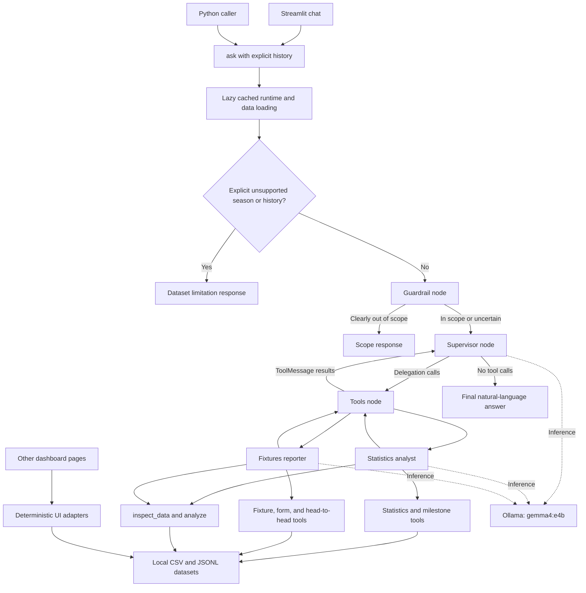

# Football Agent

### Local AI assistance and deterministic Premier League analytics

Football Agent combines a Streamlit dashboard, a LangGraph supervisor, two specialist LangChain agents, and Python analysis tools to answer questions about the **English Premier League 2024/25** using local CSV and JSONL files.

The language model interprets questions, delegates work, selects tools, and explains results. Python loads records and performs comparisons, aggregations, chronological calculations, and validation. The active application runs inference through **Ollama with `gemma4:e4b`**.

> **Data scope:** Available match reports cover **August 18–December 22, 2024**. Aggregate CSV statistics cover a broader period; all league-table rows show 38 matches played, but exact CSV snapshot dates are unknown. These are historical dataset answers, not live football updates.
>
> **Fresh-clone requirement:** `Data/` is ignored by Git. Supply the three required datasets separately before running the application or source-backed tests.

## Contents

- [Overview and objectives](#overview-and-objectives)
- [Key features](#key-features)
- [Technology stack](#technology-stack)
- [High-level architecture](#high-level-architecture)
- [Agents, tools, and execution flow](#agents-tools-and-execution-flow)
- [Repository structure](#repository-structure)
- [Prerequisites](#prerequisites)
- [Installation and setup](#installation-and-setup)
- [LLM configuration](#llm-configuration)
- [Datasets and schemas](#datasets-and-schemas)
- [Running the dashboard](#running-the-dashboard)
- [Example questions](#example-questions)
- [Python API](#python-api)
- [Analytics engine](#analytics-engine)
- [Conversation history](#conversation-history)
- [Errors and unsupported requests](#errors-and-unsupported-requests)
- [Testing and validation](#testing-and-validation)
- [Known limitations and troubleshooting](#known-limitations-and-troubleshooting)
- [Future improvements](#future-improvements)
- [Contributing and license](#contributing-and-license)

## Overview and objectives

The project separates natural-language orchestration from numerical work. Its supervisor routes statistical questions to a statistics analyst and match-oriented questions to a fixtures reporter. Both specialists can discover available fields and compose operations over normalized local data.

The analytical interface uses reusable operations rather than a separate function for every question. Hat-trick rankings, counts by player, and counts by conceding opponent can all use player-match records filtered to at least three goals.

Dedicated tools remain available for common tasks: player comparisons, standings, recent form, head-to-head records, and scoring milestones. There is no unrestricted generated Python execution, database, football-data API, or automatic dataset update process.

## Key features

| Feature | Implemented behavior |
|---|---|
| Natural-language chat | Supervisor and specialist agents use native LangChain tool calling through local Ollama. |
| Data discovery | Six analytical relations, columns, selected field meanings, identities, and coverage. |
| Composable analysis | Filtering, arithmetic, per-90 rates, grouping, sorting, cumulative totals, consecutive differences, and ordinals. |
| Player statistics | Goals, assists, appearances, minutes, starts, contributions, and available source rates. |
| Player comparison | Team-qualified resolution, ambiguity reporting, source values, and A-minus-B differences. |
| Hat-trick chronology | All qualifying player-match events ordered by date, with rank ranges for ties. |
| Goal thresholds | Configurable cumulative crossings from observed player-match records. |
| Match analysis | Available fixtures/results, latest five available matches, two-team form comparisons, and head-to-head meetings. |
| Dashboard | Compact Home summaries, shared chat history, and dedicated analysis pages. |
| Offline statistics | Direct Python tools and non-chat pages require no model inference. |
| Regression coverage | Synthetic cases, source-data checks, mocked chat, notebook parity checks, and Streamlit AppTest coverage. |

These are implemented tool capabilities. Deterministic tests do not guarantee successful live-model interpretation of every phrasing.

## Technology stack

| Component | Role |
|---|---|
| Python | Loading, normalization, calculations, validation, and application code. |
| LangChain | `create_agent`, tool schemas, messages, and specialist tool loops. |
| LangGraph | Supervisor state, guardrail routing, delegation, and response loop. |
| `langchain-ollama` | `ChatOllama` integration for the active runtime. |
| Ollama / `gemma4:e4b` | Local model server and model. |
| Streamlit | Dashboard, forms, chat, session state, caching, tables, and charts. |
| CSV / JSONL | Local aggregate statistics and match reports. |
| pytest | Deterministic, mocked, UI, and opt-in provider tests. |
| Jupyter notebooks | Standalone learning implementations and experiments with legacy provider setup. |

[requirements.txt](requirements.txt) declares `langchain`, `langchain-ollama`, `python-dotenv`, `requests`, `pytest`, and `streamlit`. Versions are unpinned. LangGraph and LangChain Core are currently supplied transitively. Jupyter and the notebooks' legacy Groq integration are not declared application dependencies.

## High-level architecture



The outer graph has three nodes: `guardrail`, `supervisor`, and `tools`. Specialists are LangChain agents invoked as supervisor tools, not additional outer graph nodes.

## Agents, tools, and execution flow

### Responsibilities and registered tools

| Component | Responsibility | Registered tools |
|---|---|---|
| Supervisor | Interpret requests, carry context into delegation, combine responses, and formulate the answer. | `call_stats_analyst(query)`, `call_fixtures_reporter(query)` |
| Statistics analyst | Player/team statistics, standings, comparisons, scoring events, and statistical plans. | `get_player_stats`, `compare_player_stats`, `get_league_table`, `get_scoring_milestones`, `inspect_data`, `analyze` |
| Fixtures reporter | Match lookups, form, head-to-head records, and match-based analytical plans. | `get_match_fixtures`, `getteam_form`, `gethead_to_head`, `inspect_data`, `analyze` |

`getteam_form` and `gethead_to_head` are existing tool names. Their underlying dictionary-returning functions are `team_form` and `head_to_head`.

| Tool interface seen by the model | Purpose |
|---|---|
| `get_player_stats(player_name=None, team=None, stat=None, limit=10)` | Filter aggregate players and rank by a supported statistic; returns JSON text. |
| `compare_player_stats(player_a, player_b, team_a=None, team_b=None)` | Resolve players and return source values, rates, and differences as JSON text. |
| `get_league_table(top_n=None)` | Stored standings sorted by source position; returns JSON text. |
| `get_scoring_milestones(question)` | Complete ranked hat-trick evidence, or legacy first-threshold analysis; returns JSON text. |
| `get_match_fixtures(matchweek=None, team=None, limit=20)` | Available reports sorted by matchweek and date; returns JSON text. |
| `getteam_form(team_a, team_b=None)` | Latest five available matches per team; returns JSON text. |
| `gethead_to_head(team_a, team_b)` | Available meetings and Team A's record; returns JSON text. |
| `inspect_data()` | Relations, fields, row counts, and limitations; returns a dictionary. |
| `analyze(dataset, steps)` | Ordered, validated analytical operations; returns a dictionary. |

Graph tools close over loaded datasets. Direct Python functions accept the corresponding dataset first; see [Python API](#python-api).

### Request lifecycle

1. Streamlit submits through `request_chat_answer()` → `run_chat_query()` → `agent.ask()`. Python callers can invoke `ask()` directly.
2. The first call to `_runtime()` loads and validates files, creates three Ollama model instances, constructs agents, and compiles the graph. The runtime is cached with `lru_cache(maxsize=1)`.
3. `ask()` accepts prior user/assistant messages and appends the new question. Explicit unsupported historical/season requests can return a limitation before graph execution, but runtime construction happens first.
4. The guardrail uses lightweight scope rules. Clearly unrelated subjects or other competitions are blocked; uncertain phrasing reaches the supervisor.
5. The supervisor chooses delegation tools. Specialists use their own LangChain tool loops to obtain deterministic evidence.
6. The outer tools node appends `ToolMessage` results and returns control to the supervisor. Specialist invocation failures are retried up to three times; exhausted failures become warning text.
7. The supervisor delegates again or responds. `ask()` returns its final message, truncating to `max_len` characters plus `...` if necessary.

Graph state contains accumulated `messages` using LangGraph's `add_messages` reducer and a `blocked` flag. There is no persistent checkpointer. Evidence-grounding instructions are prompts, not a separate automatic fact-verification stage. The runtime uses native tool calling; it does not configure `with_structured_output()` for final answers.

## Repository structure

```text
football_agent/
├── agent/
│   ├── __init__.py          # Public ask import
│   ├── workflow.py          # Lazy models, agents, tools, and StateGraph
│   ├── prompts.py           # Routing and evidence instructions
│   ├── intent.py            # Scope rules and limited typo normalization
│   ├── config.py            # Data paths and legacy Groq settings
│   ├── data_loader.py       # CSV/JSONL loading and basic validation
│   ├── analytics.py         # Six relations and analytical operations
│   ├── player_tools.py      # Lookup, comparison, and legacy formatters
│   ├── league_tools.py      # Standings and legacy leader formatter
│   ├── match_tools.py       # Fixtures, form, head-to-head, team resolution
│   └── milestone_tools.py   # Hat-tricks, thresholds, and chronology
├── Data/                    # Required local files; ignored by Git
│   ├── Table.csv
│   ├── Player_Stats.csv
│   └── match_reports.jsonl
├── tests/
│   ├── test_agent_tools.py
│   ├── test_analytics.py
│   ├── test_hat_trick_chronology.py
│   ├── test_live_analytics.py
│   ├── test_milestone_intent.py
│   └── test_streamlit_app.py
├── app.py                   # Streamlit entry point
├── notebook.ipynb           # Standalone implementation and experiments
├── test.ipynb               # Legacy setup/middleware experiment
├── requirements.txt
├── pytest.ini
├── VALIDATION.md            # Historical validation report
├── .gitignore
└── README.md
```

## Prerequisites

- Git and Python. The documentation audit used **Python 3.12.10**. The code uses modern type annotations; no complete supported-version range is declared or tested.
- Three local datasets. A clean clone does not include them.
- For chat: Ollama at `http://localhost:11434` with the exact `gemma4:e4b` tag installed.
- Enough local resources to run the model; the project defines no hardware minimum or GPU configuration.
- For dataframe/chart pages: an environment able to load Streamlit's native dependencies, including PyArrow.

No cloud API key is required for the active application. Installing dependencies or downloading a missing model requires network access; football records are read locally.

## Installation and setup

Subsequent Python commands assume an activated virtual environment and the repository root as the current directory.

### 1. Clone the project

```bash
git clone https://github.com/mahmoudshoip94/football_agent.git
cd football_agent
```

### 2. Create an environment and install dependencies

**Windows PowerShell**

```powershell
python -m venv .venv
.\.venv\Scripts\Activate.ps1
python -m pip install -r requirements.txt
```

If activation is blocked, use the interpreter directly, for example `.\.venv\Scripts\python.exe -m pip install -r requirements.txt`.

**macOS / Linux**

```bash
python3 -m venv .venv
source .venv/bin/activate
python -m pip install -r requirements.txt
```

There is no installable package configuration. Use the Python API from the repository root, or explicitly add this directory to Python's import path.

### 3. Supply the data

Create `Data/` and supply the exact filenames:

```text
Data/Table.csv
Data/Player_Stats.csv
Data/match_reports.jsonl
```

Obtain compatible files from the maintainer or another authorized source. No downloader, scraper, or data-fetch command is included. Paths resolve relative to `agent/config.py`, not the terminal's working directory.

Validate without invoking a model:

```bash
python -c "from agent.data_loader import load_datasets; print(load_datasets()[3])"
```

### 4. Prepare Ollama for chat

Install Ollama from its [official download page](https://ollama.com/download), then inspect installed models:

```bash
ollama list
```

If the exact tag is absent:

```bash
ollama pull gemma4:e4b
```

If Ollama is not already serving through its application or service, start it in another terminal:

```bash
ollama serve
```

Do not start a second server when Ollama already serves the default port. To check basic inference interactively:

```bash
ollama run gemma4:e4b
```

A plain reply does not validate the project's native tool-calling workflow.

## LLM configuration

The active [workflow](agent/workflow.py) initializes all three models with:

```python
from langchain_ollama import ChatOllama

model = ChatOllama(
    model="gemma4:e4b",
    base_url="http://localhost:11434",
)
```

The statistics specialist, fixtures specialist, and supervisor share this configuration. The supervisor uses `.bind_tools(...)`; specialists receive tools through `create_agent(...)`. There is no cloud fallback. Temperature, seed, context size, and other generation parameters are not explicitly configured.

**Configuration caveat:** The workflow hardcodes model and address. It does not read `OLLAMA_MODEL` or `OLLAMA_BASE_URL`; changing them does not select a different model or endpoint here.

### Legacy provider references

| Location | Current state |
|---|---|
| `agent/workflow.py` | Active Ollama inference; no Groq model initialization or key requirement. |
| `agent/config.py` | Groq model constants and `get_settings(require_api_key=False)`, which optionally loads `.env` and reads `GROQ_API_KEY`. The active workflow does not call it. |
| `app.py` | Obsolete Groq-key error-message branch; it does not configure the active model. |
| `notebook.ipynb` | Standalone tools, agents, graph, and experiments; model setup and connectivity checks still use Groq. |
| `test.ipynb` | Groq-key check and model constant in experimental setup. |
| `tests/test_live_analytics.py` | Calls active `ask()`, but its gate requires `GROQ_API_KEY` and `RUN_LIVE_LLM_TESTS=1`. |
| `VALIDATION.md` | Historical provider/test guidance predating the current runtime and dashboard. |

Notebooks are learning artifacts, not application entry points. They are not an Ollama-equivalent, ready-to-run setup; legacy provider dependencies are absent from `requirements.txt`. Selected deterministic functions have parity tests, but full notebook execution and provider parity are not established.

## Datasets and schemas

### Files and observed coverage

Counts were calculated from local files during this audit. Untracked data can differ between checkouts.

| File | Format | Records | Purpose and coverage |
|---|---|---:|---|
| `Data/Table.csv` | UTF-8 CSV, optional BOM | 20 | Standings; all rows have `MP=38`. Exact snapshot date unknown. |
| `Data/Player_Stats.csv` | UTF-8 CSV, optional BOM | 574 | Player/team totals and rates. Exact snapshot date unknown. |
| `Data/match_reports.jsonl` | UTF-8 JSON Lines | 158 | Played matches dated `2024-08-18` through `2024-12-22`; incomplete season. |

`Data/` is excluded by [.gitignore](.gitignore); none of these files is tracked. Repository metadata does not establish dataset provenance, redistribution rights, or a download URL.

### CSV columns

| Dataset | Columns checked by `validate_datasets()` | Additional fields used by tools |
|---|---|---|
| Table | `Rk`, `Squad`, `MP`, `Pts` | `W`, `D`, `L`, `GF`, `GA`, `GD`, `Pts/MP`, `xG`, `xGA`, `xGD`, `xGD/90`, `Top Team Scorer`, `Goalkeeper`, `Notes` |
| Players | `Player`, `Squad`, `Playing Time_Min`, `Playing Time_MP`, `Performance_Gls`, `Performance_Ast`, `Per 90 Minutes_Gls`, `Per 90 Minutes_Ast`, `Per 90 Minutes_G+A` | `Nation`, `Pos`, `Age`, `Playing Time_Starts`, `Playing Time_90s`, `Performance_G+A`, `Performance_G-PK`, `Performance_PK`, `Performance_PKatt`, `Performance_CrdY`, `Performance_CrdR`, `Per 90 Minutes_G-PK`, `Per 90 Minutes_G+A-PK` |

CSV values start as strings. Tools perform numerical conversion. Initial validation checks required column names on the first row, nonempty datasets, and basic report dates/team fields; it is not exhaustive schema or completeness validation. Some legacy presentation tools default missing numerical fields to zero; the generic engine propagates unavailable numerical inputs as `None`.

The player CSV has no `Goalkeeping_CS` field. Overall G+A per 90 and non-penalty G+A per 90 are distinct fields and must not be substituted.

### Match-report shape

A JSONL line may be a report or an object containing `match_report`. The loader unwraps that field and does not retain outer record identifiers.

| Field | Shape / purpose |
|---|---|
| `date` | ISO date, `YYYY-MM-DD`. |
| `teams.home`, `teams.away` | Objects with `name` and `score`, plus source team metadata. |
| `competition`, `matchweek` | Competition filtering and matchweek context. |
| `player_stats.home`, `player_stats.away` | Individual rows including `Player`, `Min`, `Performance_Gls`, `Performance_Ast`. |
| `keeper_stats.home`, `keeper_stats.away` | Rows including `Player`, `Min`, `Shot Stopping_GA`; additional fields include shots on target, saves, and save percentage. |
| `lineups` | Lineup/bench information; alone it does not establish participation. |
| `venue`, `attendance`, `venue_time`, `local_time`, `officials`, `title` | Additional context, not exposed by every tool. |

Summary rows named like `11 Players` are excluded from individual analytical records. Individual goal timestamps are unavailable. Kickoff times do not establish when a player completed a hat-trick.

### Loading, normalization, and caching

`load_datasets()` returns `(table_rows, player_rows, match_reports, metadata)`. CSV uses `csv.DictReader`; JSONL is parsed per nonblank line, reporting malformed JSON by line number.

The generic engine excludes invalid/out-of-competition reports and aggregate player rows, checks nonnegative integer scores, and constructs match IDs as `date|home_team|away_team`. Repeated match identities and individual rows are deduplicated in its relations. Conflicting duplicates are not comprehensively reconciled; dedicated legacy tools may normalize differently.

Streamlit caches `load_page_data()` using `st.cache_data`; the agent separately caches its runtime and loaded data. Restart after replacing files to refresh both consistently.

## Running the dashboard

```bash
python -m streamlit run app.py
```

Open Streamlit's printed URL. The sidebar defaults to **Home**.

| Page | Current interface |
|---|---|
| Home | Equal-width top panels: **four featured scorers** with team/goals/assists and **five leading teams** with points and available goal difference. Full-width chat below, with 350-pixel scrollable history and input beneath it. |
| Chat | Standalone chat sharing Home's session conversation. |
| Player Comparison | Select or enter players, resolve team identities, show values/differences and a goals/assists chart. |
| Team Form | Latest five available matches, result totals, and coverage disclosure. |
| Head-to-Head | Available meetings and the first team's record. |
| League Table | Complete stored standings with played, wins, draws, losses, goals, goal difference, and points. |

Rankings are dynamic. The featured-player helper returns up to five distinct player/team identities; Home displays four. Complete standings are on **League Table**, not a Home expander.

Opening pages loads data without invoking the model. Ollama is needed on chat submission. Home uses native text containers; dataframe pages require working PyArrow support.

## Example questions

Default context is Premier League 2024/25. These illustrate available operations, not a claim that every prompt passed live evaluation.

| Question | Evidence / calculation |
|---|---|
| “Who scored the most goals?” | Aggregate CSV ranking. |
| “Compare Mohamed Salah and Erling Haaland.” | Player comparison and source rates. |
| “Which team conceded the fewest goals?” | Stored table ranked by `GA`. |
| “Who scored the second hat-trick?” | All player-match goal counts ≥3, ordered by date, then requested rank. |
| “What was the latest hat-trick in the available reports?” | Final date/rank range with coverage disclosure. |
| “Which teams conceded the most hat-tricks?” | Filter events, group by opponent, count, sort. |
| “Who was the second player to reach 10 goals in these reports?” | Cumulative goals, first crossings, chronological ordinal; requires general analysis. |
| “Who had the best goals-per-90 rate with at least 900 minutes?” | Eligibility filter, goals × 90 / minutes, ranking. |
| “What was the highest-scoring available match?” | Score sum ranked with ties. |
| “What is Arsenal's recent form?” | Latest five available reports, not current real-world form. |
| “Show Chelsea versus Arsenal head-to-head.” | Meetings present in partial reports. |

Follow-ups such as “And the third?” require prior conversation context. All-time records, other seasons, future schedules, and complete-season chronology cannot be established from these reports.

## Python API

### Natural-language entry point

```python
from agent import ask

# Requires local data and a working Ollama tool-calling runtime.
question = "Who scored the second hat-trick in the available reports?"
answer = ask(question, max_len=6000)
print(answer)

print(ask(
    "And the third?",
    max_len=6000,
    history=[
        {"role": "user", "content": question},
        {"role": "assistant", "content": answer},
    ],
))
```

Public signature:

```text
ask(question: str, max_len: int = 1200, *, history: list[dict] | None = None) -> str
```

Only user/assistant history entries with string content are accepted. `max_len` limits output characters, not model tokens. Increase it for long lists.

### Deterministic tools without inference

```python
import json
from agent.data_loader import load_datasets
from agent.league_tools import get_league_table
from agent.match_tools import get_match_fixtures, head_to_head, team_form
from agent.player_tools import compare_players, get_player_stats

table, players, reports, metadata = load_datasets()
print(metadata)
print(json.loads(get_player_stats(players, stat="goals", limit=5)))
print(compare_players(players, "Mohamed Salah", "Erling Haaland"))
print(json.loads(get_league_table(table, top_n=5)))
print(team_form(reports, "Arsenal"))
print(head_to_head(reports, "Chelsea", "Arsenal"))
print(json.loads(get_match_fixtures(reports, matchweek=2, limit=20)))
```

Dictionary-returning signatures include `compare_players(rows, player_a, player_b, team_a=None, team_b=None)`, `team_form(match_reports, team_a, team_b=None)`, and `head_to_head(match_reports, team_a, team_b)`. Graph-facing wrappers serialize these results as JSON strings.

### Configurable scoring events

```python
from agent.data_loader import load_datasets
from agent.milestone_tools import scoring_events

_, _, reports, _ = load_datasets()
all_hat_tricks = scoring_events(reports)
second_hat_trick = scoring_events(reports, position=2)
latest_hat_trick = scoring_events(reports, position=-1)
second_ten_goal_crossing = scoring_events(reports, threshold=10, position=2)
print(second_hat_trick)
print(second_ten_goal_crossing)
```

`scoring_events(match_reports, threshold=None, position=None)` returns rows, qualifying-event count, requested position, threshold, coverage, and ambiguity information. Positions are one-based; negative positions count from the end. Selecting a tied date returns all candidates with `ambiguous` status.

### Discover and compose analysis

```python
from agent.analytics import analyze_data, discover_data
from agent.data_loader import load_datasets

table, players, reports, _ = load_datasets()
print(discover_data(table, players, reports))
result = analyze_data(table, players, reports, "player_matches", [
    {"op": "filter", "field": "Performance_Gls", "operator": "ge", "value": 3},
    {"op": "group", "by": ["player", "team"],
     "metrics": {"hat_tricks": {"agg": "count"}}},
    {"op": "sort", "by": ["hat_tricks"], "descending": True},
])
print(result)
```

Direct signatures are `discover_data(table, players, reports)` and `analyze_data(table, players, reports, dataset, steps)`. Neither invokes a model.

## Analytics engine

### Relations

| Relation | Origin | Useful fields |
|---|---|---|
| `players` | Aggregate player CSV | Source columns plus `player`, `team`. |
| `teams` | Standings CSV | Source columns plus `team`. |
| `matches` | Valid unique reports | `date`, `match_id`, home/away teams and scores, `total_goals`. |
| `team_matches` | Two perspectives per match | Match evidence, `team`, `opponent`, `side`, goals for/against, goal difference, points. |
| `player_matches` | Individual player rows | Match evidence, player/team identity, source goals/assists/minutes. |
| `keeper_matches` | Keeper rows | Match evidence, source fields, conservative `keeper_clean_sheet`. |

Inspected files produce 574 player rows, 20 team rows, 158 matches, 316 team-match rows, 4,813 player-match rows, and 320 keeper-match rows.

### Operations

| Operation | Step fields | Behavior |
|---|---|---|
| `filter` | `field`, `value`, optional `operator` | `eq`, `contains`, `in`, `ge`, `gt`, `le`, `lt`; numeric comparisons when values are numeric. |
| `derive` | `name`, `method`, `fields` | `add`, `subtract`, `per90`; per-90 is numerator × 90 / positive denominator. |
| `group` | `by`, `metrics` | `sum`, `mean`, `min`, `max`, `count`, `distinct`, `first`. |
| `cumulative` | `by`, `field`, `name` | Chronological running totals per identity, previous total, observed match count. |
| `difference` | `by`, `field`, `name` | Change from the preceding observed value, including recorded zeros. |
| `sort` | `by`, optional `descending` | One or more fields; missing values last. |
| `ordinal` | `field`, `position` | Select an ordered position and retain rows sharing its tie field. Sort first. |

Plans have at most 30 steps. Referenced columns are checked against the current relation. `first` selects the minimum non-null source value, yielding the earliest ISO date; it is not an arbitrary first-row operation. Numerical group aggregations return `None` when any contributing value is invalid/missing. Missing goals prevent later cumulative totals from being treated as complete.

Typical results include `status`, `rows`, `row_count`, `source_rows`, `steps`, `dataset`, `data_period`, `coverage_note`, `precision_note`, `identity_note`, `warnings`, and `support`. Unsupported plans may return shorter error results. There is no arbitrary SQL, generated-code execution, general join operation, or automatic pagination.

### Chronology and milestones

A hat-trick is **one player scoring at least three goals in one match**. Four goals qualify; goals across matches do not combine. Separate players in one match create separate events.

The active hat-trick tool returns all date-sorted events with `rank_start` and `rank_end`. The analyst selects the requested first/nth/latest range. Dates order events across different days. Missing timestamps matter when distinguishing events on the same date; preserve every tied candidate.

Threshold calculations sum goals chronologically by `(player, team)` and record first observed crossings of a configurable target. They establish dates and match evidence, not exact goal minutes. Observed-match counts are not full-season appearances, and a recorded crossing is not necessarily the true season crossing date.

**Interface distinction:** `scoring_events()` and general analysis support arbitrary crossing ordinals. The threshold branch of `get_scoring_milestones(question)` still uses the legacy first-crossing helper, so the model must use general analysis for second/third threshold requests. Legacy `first_hat_tricks()` and `first_to_goal_threshold()` remain available.

### Goalkeeper clean sheets

The player CSV cannot directly rank clean sheets. `keeper_clean_sheet` is populated only when a side has exactly one goalkeeper row, the keeper has exactly 90 recorded minutes, and keeper goals allowed agrees with the final team score.

For eligible rows, zero conceded yields `1`; a concession yields `0`. Other rows remain unknown. These are conservative confirmed full-match observations, not a full-season ranking or every competition rule for partial appearances.

## Conversation history

Home and Chat share `st.session_state["football_chat_messages"]`. Switching pages retains messages. Prior non-error messages are explicitly passed to `ask(history=...)`, providing backend context rather than display-only history.

The supervisor receives the conversation; specialists receive delegated queries. The supervisor must carry relevant context into those queries. There is no durable history database, user-account history, cross-session persistence, automatic summarization, or context-window trimming.

Home limits visible history to 350 pixels with autoscroll. Stored message count and the history sent to the model are unbounded.

## Errors and unsupported requests

| Condition | Handling |
|---|---|
| Missing/empty datasets or required fields | Loader raises; Streamlit displays a data-loading message and stops rendering. |
| Malformed JSONL | `ValueError` with file and line number. |
| Missing/ambiguous comparison entity | `clarification_required`, with candidates where available. |
| Unknown metric/column/operation | Unsupported result rather than arbitrary execution. |
| No qualifying rows | Generic `not_found`; dedicated tools may use statuses such as `not_reached`. |
| Explicit unsupported historical scope | Available season/reporting period explained. |
| Clearly unrelated request | Premier League scope response. |
| Specialist invocation failure | Up to three attempts, then warning text to the supervisor. |
| Chat exception reaching the UI | Sanitized timeout/provider/generic error stored in history. |

Direct `ask()` callers can receive exceptions; no universal error envelope exists. Supervisor inference has no project-defined retry loop. There is no dedicated Ollama preflight or empty-response recovery. Assistant error messages remain visible but are excluded from subsequent context.

## Testing and validation

### Commands

With dependencies installed and datasets supplied, run from the repository root:

```bash
# Complete suite, including data and Streamlit checks
python -m pytest -q

# Focused deterministic tools and chronology
python -m pytest -q tests/test_agent_tools.py tests/test_hat_trick_chronology.py tests/test_milestone_intent.py

# Source syntax
python -m compileall -q app.py agent

# Diff whitespace and conflict-marker checks
git diff --check
```

Real-data tests cannot all pass on an unprepared clone because datasets are ignored.

### Coverage

| Test module | Main coverage |
|---|---|
| `test_agent_tools.py` | Comparison, ambiguous/missing names, rates, form, head-to-head, imports, selected notebook parity. |
| `test_analytics.py` | Event/threshold edges, aggregations/rates/ranks, missing values, keeper evidence, mocked plans, notebook analysis parity. |
| `test_hat_trick_chronology.py` | First/nth/latest ranks, source reconciliation, coverage, timestamp caveats for ties. |
| `test_milestone_intent.py` | Scope/defaults, limited typos, legacy milestones, data limitations, graph-answer preservation. |
| `test_streamlit_app.py` | Home, dynamic rankings, history/navigation, no inference on opening, 40 mocked submissions, errors. |
| `test_live_analytics.py` | Seven opt-in `ask()` prompts with an obsolete Groq gate. |

Mocked `ask()` tests validate context and deterministic planning fixtures, not Gemma's independent tool selection. An intended real-StateGraph test with mocked models currently fails before dispatch because its provider mock is outdated.

### Documentation-audit results — October 15, 2026

| Check actually executed | Result |
|---|---|
| `python -m pytest -q --tb=short` | **66 passed, 7 skipped, 4 failed**. |
| Focused tools/chronology command above | **33 passed**. |
| Deterministic APIs | Imports, data loading, comparison, standings, fixtures, form, head-to-head, first/second/third/latest hat-tricks, a configurable threshold, and grouped hat-trick analysis passed. |
| Streamlit startup | Temporary headless server returned HTTP 200 / `ok` at its health endpoint, then stopped. This does not establish every browser interaction. |
| Ollama availability | `ollama list` confirmed `gemma4:e4b`. No inference or live graph query ran during this audit. |
| Python/notebooks | Source syntax and notebook JSON/code-cell syntax checked; notebooks were not executed end to end. |
| README | Local references, Python example syntax, and `git diff --check` checked. |

Four executable Python example blocks ran without inference; the `ask()` example was checked for syntax and actual API signatures only. The Ollama download link returned HTTP 200, and installed CLI help confirmed the documented `pull`, `serve`, and `run` commands. A fresh clone, new environment installation, model download, interactive inference, and macOS/Linux setup were not performed during this audit; existing local dependencies and data were used.

Four failures remain:

- `test_real_graph_routes_and_combines_tools_with_mock_models` patches nonexistent `agent.workflow.get_settings` and targets the old model initializer.
- Three Streamlit tests could not import PyArrow's DLL because local Windows Application Control blocked it: broad page rendering, comparison rendering, and team-page rendering.

All seven live tests skipped. Their gate requires `RUN_LIVE_LLM_TESTS=1` and legacy `GROQ_API_KEY`, although `ask()` uses Ollama. Align that gate before relying on it for local-provider verification. Normal application setup does not need cloud credentials.

[VALIDATION.md](VALIDATION.md) records older implementation results and Groq-oriented guidance. It is historical, not this audit's status. This documentation change does not establish a green full suite or successful live Gemma orchestration.

## Known limitations and troubleshooting

| Symptom or limitation | Explanation / action |
|---|---|
| Missing data | Supply exact filenames and run loader validation. Git does not provide the files. |
| Chat connection failure | Confirm Ollama at `http://localhost:11434` and inspect `ollama list`. No cloud fallback exists. |
| Model not found | Install exact tag `gemma4:e4b`. |
| Environment changes do nothing | Active model/address are hardcoded; legacy settings do not control them. |
| Wrong tools or empty response | Requires live integration investigation; no automatic answer verifier or empty-response repair exists. |
| Notebook requests Groq | Notebook setup is legacy. The application needs no Groq key. |
| PyArrow DLL failure | Use an environment permitted to load Streamlit's native dependencies. Policy blocks are not data issues. |
| Latest result is in December 2024 | That is report coverage, not the full season or present day. |
| Aggregate/report totals differ | They cover different periods; do not treat coverage as identical. |
| Same-date milestone tie | Missing goal timestamps; preserve candidates. |
| Player matches multiple teams | Supply qualifiers; no global IDs or automatic transfer merging. |
| Per-90 leader has few minutes | Specify a minimum-minute filter; no universal eligibility minimum is automatic. |
| Cut-off answers | `ask()` defaults to 1,200 characters; increase `max_len` in Python. Streamlit uses the default. |
| Stale data after replacement | Restart to refresh Streamlit and agent caches. |

Additional data is required for full-season chronology, true fastest season milestones, complete clean-sheet rankings, other seasons, all-time comparisons, precise goal times, and future fixtures. Consecutive changes refer to consecutive **observed** player rows, not necessarily every real appearance.

## Future improvements

These are proposals, not existing functionality:

- Align legacy configuration, notebooks, errors, and provider mocks with Ollama.
- Replace the live-test gate and evaluate actual Gemma tool selection on unseen questions and follow-ups.
- Declare direct dependency/version constraints and a supported Python range.
- Document dataset acquisition, provenance, snapshot dates, and redistribution permissions.
- Expand reports and add stable player IDs, goal timestamps, and keeper substitution intervals.
- Strengthen full-row validation and conflicting-duplicate reconciliation.
- Bound conversation context and improve local-model errors.
- Reduce threshold-routing ambiguity while preserving reusable analytical operations.

## Contributing and license

Inspect schemas, result structures, coverage notes, and callers before changing tools. Keep calculations deterministic, preserve player/team identities, and distinguish missing data from unsupported operations. Add appropriate synthetic/source-backed checks and separate live-model verification from mocked tests.

Run tests and syntax checks, review `git diff --check`, and explain remaining failures. Shared notebook behavior should retain useful standalone implementations rather than replacing learning cells with imports alone.

**License:** No license file is present in the inspected Git tree. This README assigns no license and implies no redistribution permission for code or datasets. Clarify applicable terms with the maintainer before redistribution.
